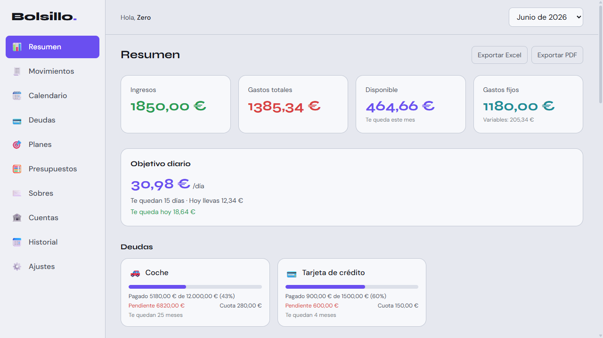

<h1 align="center">Bolsillo</h1>

<p align="center">
  <strong>Tu dinero, en tu equipo. Finanzas personales sin servidores ni cuentas.</strong><br>
  <em>Your money, on your machine. Personal finance with no servers and no accounts.</em>
</p>

<p align="center">
  <a href="https://github.com/zeroit789/bolsillo/releases/latest"><strong>Descargar para Windows / Download for Windows</strong></a>
</p>

<p align="center">
  <a href="#es"><strong>ES</strong></a> | <a href="#en"><strong>EN</strong></a>
</p>

<p align="center">
  <a href="https://github.com/zeroit789/bolsillo/actions/workflows/ci.yml"></a>
  
  
  
  
  
</p>

<p align="center">
  
</p>

> **ES:** Este README describe la rama `main`. Puede incluir cambios que todavía no están en la última versión publicada; mira [Novedades en `main`](#novedades-en-main-sin-publicar).
>
> **EN:** This README describes the `main` branch. It may include changes that are not in the latest release yet; see [What's new in `main`](#whats-new-in-main-unreleased).

---

<a id="es"></a>

## Español

### Descarga

La última versión publicada está en [Releases](https://github.com/zeroit789/bolsillo/releases/latest). Para Windows hay un instalador `.exe` (por ejemplo, `Bolsillo_1.1.0_x64-setup.exe`, el recomendado) y un `.msi`. Antes de instalar, lee [Instalar en Windows: SmartScreen y SHA256](#instalar-en-windows-smartscreen-y-sha256): el instalador no está firmado.

### Qué es

Bolsillo es una app de escritorio hecha con Tauri para llevar las finanzas personales mes a mes: ingresos, gastos, deudas, ahorro y presupuestos. No usa servidores ni cuentas, y los datos no salen de tu equipo.

Es un proyecto de portfolio de código abierto. La última versión publicada es la **1.1.0**.

**Plataformas:**

- **Windows**: es la única plataforma con instalador publicado y la única probada.
- **macOS y Linux**: Tauri permite compilarla ahí (ver [Requisitos](#requisitos)), pero no hay binarios publicados y no se ha probado en esos sistemas.

### Novedades en `main` (sin publicar)

Estos cambios están en el código, pero **no en la 1.1.0** que se descarga hoy. La 1.1.0 todavía carga las fuentes desde Google Fonts, no tiene CSP y mete los datos de ejemplo en el primer arranque.

- **Datos en un fichero cifrado**: Rust guarda los datos en `datos.bolsillo` (escritura atómica), con AES-256-GCM, clave de datos envuelta, Argon2id, clave de recuperación, copias automáticas y recibos en ficheros aparte (ya no hay tope de unos 5 MB). Los datos de la 1.1.0 se migran solos y su `localStorage` no se borra. Detalle en [Privacidad y seguridad](#privacidad-y-seguridad) y [`docs/MIGRACION.md`](docs/MIGRACION.md).
- **Versión de esquema y migraciones**: los datos guardados llevan un número de versión (ahora la 3, con fechas de calendario estrictas: una fecha imposible de antes se corrige y el valor original queda en una etiqueta). Al abrirlos, y al importar una copia, se migran a la versión actual y se validan campo a campo. Los datos sin versión se tratan como la 1.
- **La app no pisa datos que no puede leer**: si el bloque cifrado está dañado, no se descifra, no pasa la validación o lo escribió una versión más nueva de Bolsillo, aparece una pantalla de rescate en vez de cargar el ejemplo encima. Si el bloque está dañado, no es válido o es de una versión más nueva, la app intenta guardar en ese momento una copia de rescate del bloque cifrado tal cual. Si lo que falla es la credencial (los datos pueden estar bien y faltar el PIN o la contraseña), la copia se aplaza hasta que elijas importar una copia o empezar de cero. Guardar la copia puede fallar, por ejemplo si no queda espacio: entonces la pantalla lo avisa, pide descargar antes los datos ilegibles y solo deja importar o empezar de cero si confirmas que se perderán. La pantalla también permite descargar el bloque y probar otra credencial, y empezar de cero no borra la copia de rescate.
- **Aviso si falla el guardado**: si no se puede guardar (por ejemplo, porque el almacenamiento está lleno), sale un aviso fijo con botón de reintentar, y la app reintenta sola cada vez más espaciado (de 2 a 60 segundos). Al cerrar la ventana, la app intenta guardar lo pendiente; si falla o tarda más de 5 segundos, pide confirmación antes de cerrar sin esos cambios.
- **Empezar vacío o con ejemplo**: la bienvenida pregunta si quieres empezar sin datos (la opción por defecto) o con los de ejemplo. En Ajustes hay dos botones, «Empezar de cero» y «Cargar ejemplo», los dos con confirmación; «Empezar de cero» quita los datos de ejemplo de una vez.
- **Fuentes locales**: Syne y DM Sans van dentro de la app, así que no hay ninguna petición a Google Fonts. Sus licencias OFL 1.1 están en [`src/assets/fonts/`](src/assets/fonts/) y el build las copia a `dist/licencias/`.
- **CSP** definida en `src-tauri/tauri.conf.json` (en la 1.1.0 era `null`).
- **Accesibilidad**: se puede usar con el teclado, el foco se ve en los dos temas, los diálogos tienen `role="dialog"`, título asociado, foco atrapado y se cierran con `Esc`, los botones de icono y los campos tienen nombre accesible, y se respeta `prefers-reduced-motion`.
- **Exportación bajo demanda**: ExcelJS y jsPDF solo se cargan al exportar. El bundle principal pasa de unos 1.612 kB a 245 kB.
- **Otros**: identificadores con `crypto.randomUUID()`, un único redondeo de importes (`utils/importe.ts`), dependencias al día y `cargo clippy` en la CI.

### Funcionalidades

- **Movimientos**: gastos e ingresos fijos (se repiten cada mes, con día de pago opcional) o puntuales. Cada uno con categoría, fecha, comercio, etiquetas, cuenta y foto del recibo. Buscador y filtro por tipo.
- **Gasto dividido**: un mismo gasto repartido entre varias categorías.
- **Plantillas de alta rápida**: movimientos habituales que se registran con un clic.
- **Deudas**: tarjeta, préstamo, coche, hipoteca… con total, cuota mensual, lo ya pagado y día de cobro. La cuota cuenta como gasto fijo y la deuda se va saldando sola mes a mes (barra de progreso y meses restantes).
- **Planes de ahorro**: metas con objetivo y aportaciones.
- **Presupuestos por categoría** y **sobres** para repartir el dinero del mes.
- **Cuentas y patrimonio**: varias cuentas o monederos con saldo inicial y patrimonio total.
- **Resumen del mes**: tarjetas de ingresos, gastos, disponible y gastos fijos; objetivo de gasto diario; gasto por categoría (gráfica de dona); evolución de ingresos y gastos; previsión de caja a 6 meses.
- **Calendario** con mapa de calor del gasto diario.
- **Historial**: tabla mes a mes, resumen anual, comparativa con el mes anterior y ranking de comercios («dónde gastas»).
- **Exportación**: el mes a Excel (XLSX) y PDF; el historial a XLSX, PDF y CSV. Se guarda con el diálogo nativo de «Guardar como».
- **Copias de seguridad**: copia **cifrada** (`.bolsillo`) con su propia contraseña y con los recibos dentro; copia JSON legible (**sin cifrar**); importar cualquiera de las dos (también la de la 1.1.0); y copias automáticas en el equipo (las 10 últimas y una por día durante 30 días) que se restauran desde Ajustes. Ver [Privacidad y seguridad](#privacidad-y-seguridad).
- **Bloqueo**: PIN o contraseña, clave de recuperación para apuntar o imprimir, «Bloquear ahora» (también con el candado de la barra superior) y autobloqueo por inactividad configurable.
- **Datos de ejemplo** inventados (una nómina, un alquiler, un coche a plazos…), opcionales. No son de ninguna persona real.
- **Notificaciones nativas**: deuda saldada, pagos próximos y recordatorio mensual.
- **Ajustes**: tema claro u oscuro, moneda (EUR, USD, GBP, MXN, ARS, COP, CLP, BRL), idioma, categorías propias, bloqueo y datos (empezar de cero o cargar el ejemplo).
- **Español e inglés**, con cambio en caliente. En el primer arranque detecta el idioma del sistema.
- **Atajos de teclado** en Movimientos: `N` abre el alta de un movimiento y `Esc` cierra el formulario.

### Privacidad y seguridad

Los datos se guardan en tu equipo, en un fichero cifrado dentro del directorio de datos de la app (en Windows, `%APPDATA%\com.zeroit.bolsillo\datos.bolsillo`). Lo escribe el backend en Rust; el frontend no elige rutas. No hay telemetría ni llamadas a servidores, y la versión de `main` no hace ninguna petición externa. La 1.1.0 los guardaba en el `localStorage` del WebView: la primera vez que esta versión los lee, los migra al fichero sin borrar el original. Qué ficheros hay, cómo es la migración y cómo volver a la 1.1.0: [`docs/MIGRACION.md`](docs/MIGRACION.md).

**Cómo se cifran** (`src-tauri/src/`): el contenido va cifrado con **AES-256-GCM** (crate `aes-gcm` 0.11.1) con una **clave de datos aleatoria de 256 bits**. Esa clave se guarda "envuelta" (cifrada) en la cabecera del fichero, una vez por cada forma de abrir:

- **Con PIN o contraseña**: con una clave derivada de tu credencial con **Argon2id** (crate `argon2` 0.6.0) a m = 46 MiB, t = 1, p = 1, la primera configuración mínima de la [OWASP Password Storage Cheat Sheet](https://cheatsheetseries.owasp.org/cheatsheets/Password_Storage_Cheat_Sheet.html) (consultada el 19-11-2026). Los parámetros y la sal van en la cabecera.
- **Con la clave de recuperación**: se crea al poner el PIN o la contraseña (32 símbolos en 8 grupos, con comprobación de erratas) y se enseña una vez para que la apuntes. Abre los datos si olvidas el PIN. Cambiar el PIN no la invalida; generar otra sí.
- **Sin PIN ni contraseña**: con una clave fija que está en el código público. **Eso no protege nada**: cualquiera que lea el fichero puede abrirlo. Solo evita que se vea a simple vista.

La clave se deriva una vez al desbloquear y la clave de datos se queda en la memoria de Rust hasta que bloqueas (al bloquear se borra con `zeroize`). Hay «Bloquear ahora» y autobloqueo por inactividad (10 minutos por defecto). El tipo de bloqueo está en la cabecera del fichero, así que borrar los ajustes no quita el PIN. Al poner o quitar el PIN, o al generar otra clave de recuperación, la clave de datos cambia: lo que guardes después no se abre con ficheros viejos. Al poner el PIN, las copias automáticas que estaban solo ofuscadas pasan a pedirlo; si alguna no se puede actualizar (por ejemplo, sin espacio), la app lo avisa y lo reintenta la próxima vez que entres con el PIN. Si el fichero cambia fuera de la app mientras está abierta, no se sobrescribe: la app avisa. Restaurar una copia automática la abre y comprueba antes con su PIN, así que una copia dañada no sustituye a tus datos.

**Cuánto protege.** Argon2id hace cada intento mucho más caro que el PBKDF2 de la 1.1.0, pero un PIN de 4 cifras solo tiene 10.000 combinaciones: quien se lleve el fichero puede probarlas todas en su equipo. El PIN evita que alguien que abra la app en tu equipo vea tus datos; frente a una copia del fichero, usa una **contraseña larga** (mínimo 8 caracteres; mejor una frase de varias palabras). La app avisa si el PIN es de los fáciles (1234, 0000, 1212, años…).

**Copias automáticas** (`copias\`): las 10 últimas versiones (como mucho una cada 10 minutos) y una por día durante 30 días, cifradas igual que el original. Un fichero que no se puede leer nunca se pisa: se aparta a `rescate\`. Las copias están en el mismo disco: guarda también una **copia cifrada** fuera del PC (va con su propia contraseña, de al menos 8 caracteres, y se guarda con el diálogo nativo). La copia **JSON** se sigue pudiendo exportar e importar, pero **va sin cifrar**: lleva todos tus datos y fotos de recibos en texto legible.

**Lo que se guarda en claro**, en el `localStorage` del WebView:

- `bolsillo.ajustes`: tema, idioma, moneda, tu nombre, una copia del tipo de bloqueo (manda la del fichero), minutos del autobloqueo y si ya pasaste la bienvenida.
- `bolsillo.categorias-custom`: los nombres de tus categorías propias.
- `bolsillo.mes-visto`: el último mes que abriste.
- `bolsillo.deudas.notificadas`, `bolsillo.pagos-avisados` y `bolsillo.recordatorio-mes`: control de las notificaciones (identificadores internos y el mes del último recordatorio). No llevan importes ni conceptos.
- Si venías de la 1.1.0, `bolsillo.datos.cif` (y sus `bolsillo.datos.rescate.<fecha>`) siguen ahí con la protección de entonces (PBKDF2 a 150.000 iteraciones, u ofuscación sin PIN). No se borran para poder volver atrás.

**CSP** (`src-tauri/tauri.conf.json`, `csp` y `devCsp`): por defecto solo lo propio (`default-src 'self'`); solo código propio (`script-src 'self'`, sin `eval`); estilos propios y también en línea (`style-src 'self' 'unsafe-inline'`); fuentes propias (`font-src 'self'`); imágenes propias y en `data:`/`blob:` (recibos); conexiones solo a la propia app y al IPC de Tauri (`connect-src 'self' ipc: http://ipc.localhost`; en desarrollo también al servidor de Vite, `ws://localhost:1420` y `http://localhost:1420`); y nada de `object`, `frame` ni `base`/`form-action` ajenos (`object-src 'none'`, `frame-src 'none'`, `base-uri 'self'`, `form-action 'self'`).

### Instalar en Windows: SmartScreen y SHA256

El instalador **no está firmado** con un certificado de código, así que Windows avisa al abrirlo:

1. SmartScreen muestra **«Windows protegió su PC»**.
2. Pulsa **«Más información»** y después **«Ejecutar de todas formas»**.

Hazlo solo si has descargado el archivo de la página de [Releases](https://github.com/zeroit789/bolsillo/releases/latest) de este repositorio. Antes, comprueba su SHA256 en PowerShell:

```powershell
Get-FileHash .\Bolsillo_1.1.0_x64-setup.exe -Algorithm SHA256
```

Compara el resultado con el SHA256 que GitHub calcula para cada archivo de la release. Lo ves en la página de la release, junto a cada archivo, o con `gh release view v1.1.0 -R zeroit789/bolsillo --json assets`. Las notas de la 1.1.0 no incluyen los hashes; a partir de la 1.2.0 se publicarán también en las notas. Que el hash coincida demuestra que el archivo es el mismo que se subió a la release, no que se haya compilado a partir de este código.

**Smart App Control**: si lo tienes activado, Windows bloquea las apps sin firmar y no permite excepciones para una app concreta ([FAQ de Microsoft](https://support.microsoft.com/windows/smart-app-control-faq-285ea03d-fa88-4d56-882e-6698afdb7003)). Con Smart App Control activo no podrás instalar Bolsillo.

### Stack

Versiones exactas de `pnpm-lock.yaml` y `src-tauri/Cargo.lock`:

| Pieza                         | Paquete                                                      | Versión                    |
| ----------------------------- | ------------------------------------------------------------ | -------------------------- |
| Núcleo de escritorio          | `tauri` (Rust) · `@tauri-apps/cli`                           | 2.12.5 · 2.12.5            |
| API de Tauri para el frontend | `@tauri-apps/api`                                            | 2.12.5                     |
| Plugins de Tauri              | `plugin-dialog` · `plugin-notification` · `plugin-opener`    | 2.8.4 · 2.8.1 · 2.7.3      |
| Interfaz                      | `vue`                                                        | 3.5.45                     |
| Estado                        | `pinia`                                                      | 3.0.4                      |
| Estilos                       | `tailwindcss` · `@tailwindcss/vite`                          | 4.3.5 · 4.3.5              |
| Fuentes                       | `@fontsource-variable/syne` · `@fontsource-variable/dm-sans` | 5.3.0 · 5.3.0              |
| Build                         | `vite` · `@vitejs/plugin-vue`                                | 6.4.6 · 5.2.4              |
| Tipos                         | `typescript` · `vue-tsc`                                     | 5.6.3 · 2.2.12             |
| Lint y formato                | `eslint` · `eslint-plugin-vue` · `prettier`                  | 10.15.0 · 10.12.1 · 3.10.1 |
| Tests                         | `vitest` · `happy-dom`                                       | 5.1.1 · 21.0.4             |
| Exportación                   | `exceljs` · `jspdf` · `jspdf-autotable`                      | 4.4.0 · 4.2.1 · 5.0.9      |
| Serialización (Rust)          | `serde` · `serde_json`                                       | 1.0.228 · 1.0.150          |

Los crates de los plugins (`tauri-plugin-dialog`, `-notification`, `-opener`) llevan las mismas versiones que sus paquetes npm.

### Requisitos

- [Node.js](https://nodejs.org) 24 y [pnpm](https://pnpm.io) 12 (las versiones que usa la CI).
- [Rust](https://rustup.rs) estable y los [requisitos previos de Tauri](https://tauri.app/start/prerequisites/) de tu sistema. Solo hacen falta para la app de escritorio; el frontend en el navegador funciona sin Rust.

### Compilar y comandos

```bash
pnpm install          # instala las dependencias
pnpm tauri:dev        # app de escritorio en modo desarrollo (perfil «Bolsillo Dev»)
pnpm dev              # solo el frontend, en el navegador (http://localhost:1420)
pnpm build            # comprueba tipos (vue-tsc) y genera el frontend en dist/
pnpm preview          # sirve el build de dist/ para revisarlo
pnpm lint             # ESLint (Vue + TypeScript)
pnpm format           # formatea el código con Prettier
pnpm format:check     # comprueba el formato sin tocar nada
pnpm test             # tests con Vitest
pnpm tauri:build:dev  # ejecutable de pruebas «Bolsillo Dev» en src-tauri/target/release/, sin instaladores
pnpm tauri build      # ejecutable e instaladores de la versión publicada en src-tauri/target/release/bundle/
```

**Perfil de desarrollo.** `pnpm tauri:dev` y `pnpm tauri:build:dev` fusionan `src-tauri/tauri.dev.conf.json` (JSON Merge Patch, RFC 7396) con la configuración normal. Cambian el nombre a «Bolsillo Dev» y el identificador a `com.zeroit.bolsillo.dev`, así que los datos de pruebas van a otra carpeta y no tocan los de la app instalada. **`pnpm tauri dev` a pelo usa el identificador de producción (`com.zeroit.bolsillo`) y abre los datos reales**: úsalo solo si sabes lo que haces.

En el navegador (`pnpm dev`) la interfaz funciona, pero lo que depende de Tauri (diálogo de guardar al exportar y notificaciones nativas) solo va dentro de la app de escritorio.

### Tests y CI

- **Tests** (`pnpm test`): 378 tests en 29 ficheros, con Vitest y happy-dom, junto al código (`src/**/*.test.ts`); los de la sesión corren contra el backend de Rust simulado (`src/utils/rustSimulado.ts`), con las mismas reglas que el real. Cubren las deudas (cuotas, última cuota parcial, aviso de saldada), los planes, la comparativa entre meses y el resumen mensual, el redondeo de importes y su validación en los formularios (vacío, inválido, por encima del tope, gasto dividido y aportaciones a planes), la exportación a CSV/XLSX/PDF (con el diálogo y el comando de Tauri simulados), la importación y validación de copias, el cifrado con PIN (ida y vuelta, PIN incorrecto, datos manipulados y flujo de bloqueo completo), la recuperación ante datos ilegibles (en localStorage y en el fichero), la migración en tres fases y que no se remigra encima del fichero, las copias automáticas y la copia cifrada, el guardado (fallo, reintento, debounce, reemplazo que guarda antes de publicar y cambio de PIN), «Bloquear ahora» y el autobloqueo, los mínimos de credencial y el aviso de PIN débil, y el foco de los diálogos. Además, `cargo test` (72 tests) prueba el almacén cifrado de Rust.
- **Lint** (`pnpm lint`): ESLint con la flat config oficial de Vue + TypeScript (`eslint-plugin-vue` _essential_ + `vueTsConfigs.recommended`).
- **Formato** (`pnpm format:check`): Prettier, separado del lint (`@vue/eslint-config-prettier/skip-formatting` evita que choquen).
- **CI** ([`.github/workflows/ci.yml`](.github/workflows/ci.yml)), en cada push y pull request a `main`:
  1. **Secretos**: `gitleaks` 8.30.1 (binario verificado por SHA256) sobre todo el historial.
  2. **Frontend**: `pnpm install --frozen-lockfile`, `pnpm lint`, `pnpm format:check`, `pnpm test`, `vue-tsc --noEmit` y `vite build` con Node 24 y pnpm 12.
  3. **Rust**: en Windows (`windows-latest`, con caché de cargo), después del `vite build` que Tauri necesita para compilar: `cargo check --locked`, `cargo clippy --all-targets --locked -- -D warnings` y `cargo test --locked` (los tests del almacén cifrado: cifrado, PIN correcto e incorrecto, clave de recuperación sin PIN, datos grandes, recibos, fichero dañado, escritura atómica con fallo a mitad, copias rotativas, migración y copia cifrada). Comprueba tipos, dependencias (con el `Cargo.lock` tal cual) y los avisos de clippy; no genera el instalador.

  Las acciones de GitHub van fijadas por SHA completo.

Para repetir la CI en local: `pnpm install --frozen-lockfile && pnpm lint && pnpm format:check && pnpm test && pnpm build`, y en `src-tauri/`, `cargo clippy --all-targets -- -D warnings` y `cargo test`.

### Estructura

```
bolsillo/
├─ .github/workflows/ci.yml   # CI: gitleaks + lint + formato + tests + vue-tsc + build + cargo check + clippy + cargo test
├─ docs/screenshot.png        # captura del README (datos de ejemplo)
├─ docs/MIGRACION.md          # ficheros de datos, migración desde la 1.1.0 y vuelta atrás
├─ art/                       # material gráfico
├─ public/                    # recursos estáticos
├─ index.html                 # página que monta la app
├─ vite.config.ts             # build de Vite (copia las licencias de las fuentes a dist/licencias/)
├─ src/                       # frontend (Vue 3 + TypeScript)
│  ├─ App.vue                 # navegación, bloqueo, onboarding, aviso de guardado y notificaciones
│  ├─ main.ts                 # arranque de Vue y Pinia
│  ├─ i18n.ts                 # traducciones reactivas ES/EN
│  ├─ assets/main.css         # tema de Tailwind (oscuro y claro), foco visible y menos movimiento
│  ├─ assets/fonts/           # Syne y DM Sans locales (fuentes.css) y sus licencias OFL
│  ├─ views/                  # 10 pantallas: resumen, movimientos, calendario, deudas,
│  │                          #   planes, presupuestos, sobres, cuentas, historial, ajustes
│  ├─ components/             # gráficas, modal de movimiento, onboarding, bloqueo,
│  │                          #   AvisoGuardado (fallo al guardar) y PantallaErrorDatos (rescate)
│  ├─ stores/                 # Pinia: finanzas, ajustes y sesión (bloqueo, guardado y recuperación)
│  ├─ utils/                  # boveda.ts (puente con el almacén cifrado de Rust), rustSimulado.ts
│  │                          #   (Rust simulado: tests y pnpm dev), cripto.ts y almacen.ts (almacén
│  │                          #   heredado de la 1.1.0), migraciones.ts, credencial.ts, autobloqueo.ts,
│  │                          #   export.ts, importe.ts (redondeo), id.ts (identificadores),
│  │                          #   useFocoAtrapado.ts (foco de diálogos), formato, deudas,
│  │                          #   planes, comparativa, avisos (+ sus *.test.ts)
│  ├─ data/                   # categorías por defecto y datos de ejemplo
│  └─ types/                  # tipos del dominio, versión del esquema y validación
└─ src-tauri/                 # capa nativa (Rust)
   ├─ src/lib.rs              # plugins y comandos (almacén, copias, guardar_archivo con diálogo)
   ├─ src/boveda.rs           # almacén: abrir, guardar, crear, migrar, bloqueo, recuperación y copias
   ├─ src/formato.rs          # formato del fichero: cabecera en claro y clave de datos envuelta
   ├─ src/cripto.rs           # Argon2id, AES-256-GCM y bytes aleatorios
   ├─ src/recuperacion.rs     # clave de recuperación con comprobación de erratas
   ├─ src/directorio.rs       # escritura atómica, copias rotativas, rescate y recibos
   ├─ src/main.rs             # punto de entrada
   ├─ capabilities/           # permisos de la ventana
   ├─ tauri.conf.json         # ventana, CSP, build e instaladores
   └─ tauri.dev.conf.json     # perfil de desarrollo (com.zeroit.bolsillo.dev)
```

El código lleva comentarios en español y en inglés.

### Licencia

[MIT](LICENSE) © 2026 Daniel Castaños Mefle · [danimefle.com](https://danimefle.com)

Las fuentes Syne y DM Sans (paquetes `@fontsource-variable/syne` y `@fontsource-variable/dm-sans`) tienen licencia SIL Open Font License 1.1; el texto de cada una está en [`src/assets/fonts/`](src/assets/fonts/) (`LICENSE-*-OFL.txt`) y el build lo copia a `dist/licencias/`.

---

<a id="en"></a>

## English

### Download

The latest release is on [Releases](https://github.com/zeroit789/bolsillo/releases/latest). For Windows there's an `.exe` installer (for example `Bolsillo_1.1.0_x64-setup.exe`, the recommended one) and an `.msi`. Before installing, read [Installing on Windows: SmartScreen and SHA256](#installing-on-windows-smartscreen-and-sha256): the installer isn't signed.

### What it is

Bolsillo is a desktop app built with Tauri for tracking your personal finances month by month: income, expenses, debts, savings and budgets. There are no servers and no accounts, and your data never leaves your computer.

It's an open-source portfolio project. The latest release is **1.1.0**.

**Platforms:**

- **Windows**: the only platform with a published installer, and the only one tested.
- **macOS and Linux**: Tauri lets you build it there (see [Requirements](#requirements)), but there are no published binaries and it hasn't been tested on those systems.

### What's new in `main` (unreleased)

These changes are in the code but **not in 1.1.0**, which is what you download today. 1.1.0 still loads its fonts from Google Fonts, has no CSP and loads the sample data on first launch.

- **Data in an encrypted file**: Rust stores the data in `datos.bolsillo` (atomic writes), with AES-256-GCM, a wrapped data key, Argon2id, a recovery key, automatic backups and receipts in separate files (there's no longer a ~5 MB cap). 1.1.0 data is migrated automatically and its `localStorage` isn't deleted. Details in [Privacy and security](#privacy-and-security) and [`docs/MIGRACION.md`](docs/MIGRACION.md).
- **Schema version and migrations**: saved data carries a version number (currently 3, with strict calendar dates: an impossible old date is fixed and the original value is kept in a tag). When it's opened, and when a backup is imported, it's migrated to the current version and validated field by field. Data with no version is treated as version 1.
- **The app doesn't overwrite data it can't read**: if the encrypted blob is damaged, doesn't decrypt, fails validation or was written by a newer Bolsillo, you get a rescue screen instead of the sample data loaded on top. If the blob is damaged, invalid or from a newer version, the app tries to save a rescue copy of the encrypted blob as is right away. If the credential is what fails (the data may be fine and only the PIN or password be missing), the copy is put off until you choose to import a backup or start from scratch. Saving the copy can fail, for example when there is no space left: the screen then says so, asks you to download the unreadable data first and only lets you import or start from scratch if you confirm it will be lost. The screen also lets you download the blob and try another credential, and starting from scratch doesn't delete the rescue copy.
- **Warning when saving fails**: if the data can't be saved (for example, because storage is full), a persistent warning with a retry button appears, and the app retries on its own with growing gaps (2 to 60 seconds). When you close the window, the app tries to save anything pending; if that fails or takes more than 5 seconds, it asks for confirmation before closing without those changes.
- **Start empty or with samples**: the welcome screen asks whether to start with no data (the default) or with the sample data. Settings has two buttons, "Start from scratch" and "Load samples", both with a confirmation; "Start from scratch" removes the sample data in one go.
- **Local fonts**: Syne and DM Sans ship inside the app, so there are no requests to Google Fonts. Their OFL 1.1 licenses are in [`src/assets/fonts/`](src/assets/fonts/) and the build copies them to `dist/licencias/`.
- **CSP** set in `src-tauri/tauri.conf.json` (in 1.1.0 it was `null`).
- **Accessibility**: usable from the keyboard, visible focus in both themes, dialogs with `role="dialog"`, a linked title, trapped focus and `Esc` to close, accessible names on icon buttons and fields, and `prefers-reduced-motion` is respected.
- **On-demand export**: ExcelJS and jsPDF only load when you export. The main bundle drops from about 1,612 kB to 245 kB.
- **Other**: IDs from `crypto.randomUUID()`, a single place for rounding amounts (`utils/importe.ts`), updated dependencies and `cargo clippy` in CI.

### Features

- **Transactions**: recurring expenses and income (repeat every month, with an optional payment day) or one-off ones. Each has a category, date, merchant, tags, account and a receipt photo. Search box and type filter.
- **Split expenses**: spread a single expense across several categories.
- **Quick-add templates**: log your usual transactions with one click.
- **Debts**: credit card, loan, car, mortgage… with total, monthly payment, amount already paid and charge day. The payment counts as a recurring expense and the debt pays itself down month by month (progress bar and months left).
- **Savings plans**: goals with a target and contributions.
- **Category budgets** and **envelopes** to split up the month's money.
- **Accounts and net worth**: multiple accounts or wallets with a starting balance and a total net worth.
- **Monthly summary**: income, expenses, available and recurring-expense cards; a daily spending target; spending by category (donut chart); income vs. expense trend; 6-month cash flow forecast.
- **Calendar** with a heat map of daily spending.
- **History**: month-by-month table, yearly summary, comparison with last month and a merchant ranking ("where your money goes").
- **Export**: the month to Excel (XLSX) and PDF; the history to XLSX, PDF and CSV, through the native "Save as" dialog.
- **Backups**: an **encrypted** backup (`.bolsillo`) with its own password and the receipts inside; a readable JSON backup (**unencrypted**); importing either of them (also the 1.1.0 one); and automatic backups on the computer (the last 10 and one per day for 30 days) restored from Settings. See [Privacy and security](#privacy-and-security).
- **Lock**: PIN or password, a recovery key to write down or print, "Lock now" (also with the padlock in the top bar) and a configurable inactivity auto-lock.
- **Sample data**, made up and optional (a paycheck, rent, a car loan…). None of it belongs to a real person.
- **Native notifications**: debt paid off, upcoming payments and a monthly reminder.
- **Settings**: light or dark theme, currency (EUR, USD, GBP, MXN, ARS, COP, CLP, BRL), language, custom categories, lock, and data (start from scratch or load the samples).
- **Spanish and English**, switchable on the fly. The system language is detected on first launch.
- **Keyboard shortcuts** in Transactions: `N` opens the new-transaction form and `Esc` closes it.

### Privacy and security

Data is stored on your computer, in an encrypted file inside the app data directory (on Windows, `%APPDATA%\com.zeroit.bolsillo\datos.bolsillo`). The Rust backend writes it; the frontend does not pick paths. There's no telemetry and no calls to any server, and the `main` version makes no outside requests. 1.1.0 kept the data in the WebView `localStorage`: the first time this version reads it, it migrates it to the file without deleting the original. Which files exist, how the migration works and how to go back to 1.1.0: [`docs/MIGRACION.md`](docs/MIGRACION.md).

**How it's encrypted** (`src-tauri/src/`): the content is encrypted with **AES-256-GCM** (crate `aes-gcm` 0.11.1) with a **random 256-bit data key**. That key is stored "wrapped" (encrypted) in the file header, once for each way to open it:

- **With a PIN or password**: with a key derived from your credential with **Argon2id** (crate `argon2` 0.6.0) at m = 46 MiB, t = 1, p = 1, the first minimum configuration of the [OWASP Password Storage Cheat Sheet](https://cheatsheetseries.owasp.org/cheatsheets/Password_Storage_Cheat_Sheet.html) (checked on 2026-11-19). The parameters and salt live in the header.
- **With the recovery key**: created when you set the PIN or password (32 symbols in 8 groups, with typo detection) and shown once so you can write it down. It opens the data if you forget the PIN. Changing the PIN doesn't invalidate it; generating a new one does.
- **With no PIN or password**: with a fixed key that lives in the public code. **That protects nothing**: anyone who can read the file can open it. It only keeps it from being readable at a glance.

The key is derived once when you unlock, and the data key stays in Rust's memory until you lock (on lock it's wiped with `zeroize`). There's "Lock now" and an inactivity auto-lock (10 minutes by default). The lock type lives in the file header, so wiping the settings doesn't remove the PIN. When you set or remove the PIN, or generate a new recovery key, the data key changes: what you save afterwards can't be opened with old files. When you set the PIN, the automatic backups that were only obfuscated start asking for it; if one can't be updated (for example, no space left), the app warns you and retries the next time you get in with the PIN. If the file changes outside the app while it's open, it isn't overwritten: the app warns you. Restoring an automatic backup first opens and checks it with its PIN, so a damaged backup never replaces your data.

**How much it protects.** Argon2id makes each guess far more expensive than 1.1.0's PBKDF2, but a 4-digit PIN only has 10,000 combinations: whoever takes the file can try them all on their own computer. A PIN keeps someone who opens the app on your computer from seeing your data; against a copy of the file, use a **long password** (8 characters minimum; better a phrase of several words). The app warns you if the PIN is an easy one (1234, 0000, 1212, years…).

**Automatic backups** (`copias\`): the last 10 versions (at most one every 10 minutes) and one per day for 30 days, encrypted like the original. A file that can't be read is never overwritten: it's moved to `rescate\`. The backups are on the same disk: also keep an **encrypted backup** off the PC (it has its own password, at least 8 characters, and is saved with the native dialog). The **JSON** backup can still be exported and imported, but it's **unencrypted**: it holds all your data and receipt photos as readable text.

**What's stored in plain text**, in the WebView `localStorage`:

- `bolsillo.ajustes`: theme, language, currency, your name, a copy of the lock type (the file's one rules), the auto-lock minutes and whether you've finished the welcome screen.
- `bolsillo.categorias-custom`: the names of your custom categories.
- `bolsillo.mes-visto`: the last month you opened.
- `bolsillo.deudas.notificadas`, `bolsillo.pagos-avisados` and `bolsillo.recordatorio-mes`: notification bookkeeping (internal IDs and the month of the last reminder). They hold no amounts or descriptions.
- If you came from 1.1.0, `bolsillo.datos.cif` (and its `bolsillo.datos.rescate.<date>`) are still there with the protection they had then (PBKDF2 at 150,000 iterations, or obfuscation without a PIN). They're kept so you can go back.

**CSP** (`src-tauri/tauri.conf.json`, `csp` and `devCsp`): only the app's own sources by default (`default-src 'self'`); only the app's own code (`script-src 'self'`, no `eval`); its own styles plus inline ones (`style-src 'self' 'unsafe-inline'`); its own fonts (`font-src 'self'`); its own images plus `data:`/`blob:` (receipts); connections only to the app itself and to Tauri's IPC (`connect-src 'self' ipc: http://ipc.localhost`; in development also to the Vite server, `ws://localhost:1420` and `http://localhost:1420`); and no outside `object`, `frame` or `base`/`form-action` (`object-src 'none'`, `frame-src 'none'`, `base-uri 'self'`, `form-action 'self'`).

### Installing on Windows: SmartScreen and SHA256

The installer **isn't signed** with a code-signing certificate, so Windows warns you when you open it:

1. SmartScreen shows **"Windows protected your PC"**.
2. Click **"More info"** and then **"Run anyway"**.

Only do this if you downloaded the file from this repository's [Releases](https://github.com/zeroit789/bolsillo/releases/latest) page. Check its SHA256 in PowerShell first:

```powershell
Get-FileHash .\Bolsillo_1.1.0_x64-setup.exe -Algorithm SHA256
```

Compare the result with the SHA256 GitHub computes for each release file. You can see it on the release page, next to each file, or with `gh release view v1.1.0 -R zeroit789/bolsillo --json assets`. The 1.1.0 release notes don't include the hashes; from 1.2.0 on they'll be in the notes too. A matching hash proves the file is the one uploaded to the release, not that it was built from this code.

**Smart App Control**: if it's on, Windows blocks unsigned apps and doesn't allow exceptions for a single app ([Microsoft FAQ](https://support.microsoft.com/windows/smart-app-control-faq-285ea03d-fa88-4d56-882e-6698afdb7003)). With Smart App Control on, you won't be able to install Bolsillo.

### Stack

Exact versions from `pnpm-lock.yaml` and `src-tauri/Cargo.lock`:

| Part                       | Package                                                      | Version                    |
| -------------------------- | ------------------------------------------------------------ | -------------------------- |
| Desktop core               | `tauri` (Rust) · `@tauri-apps/cli`                           | 2.12.5 · 2.12.5            |
| Tauri API for the frontend | `@tauri-apps/api`                                            | 2.12.5                     |
| Tauri plugins              | `plugin-dialog` · `plugin-notification` · `plugin-opener`    | 2.8.4 · 2.8.1 · 2.7.3      |
| UI                         | `vue`                                                        | 3.5.45                     |
| State                      | `pinia`                                                      | 3.0.4                      |
| Styling                    | `tailwindcss` · `@tailwindcss/vite`                          | 4.3.5 · 4.3.5              |
| Fonts                      | `@fontsource-variable/syne` · `@fontsource-variable/dm-sans` | 5.3.0 · 5.3.0              |
| Build                      | `vite` · `@vitejs/plugin-vue`                                | 6.4.6 · 5.2.4              |
| Types                      | `typescript` · `vue-tsc`                                     | 5.6.3 · 2.2.12             |
| Linting and formatting     | `eslint` · `eslint-plugin-vue` · `prettier`                  | 10.15.0 · 10.12.1 · 3.10.1 |
| Tests                      | `vitest` · `happy-dom`                                       | 5.1.1 · 21.0.4             |
| Export                     | `exceljs` · `jspdf` · `jspdf-autotable`                      | 4.4.0 · 4.2.1 · 5.0.9      |
| Serialization (Rust)       | `serde` · `serde_json`                                       | 1.0.228 · 1.0.150          |

The plugin crates (`tauri-plugin-dialog`, `-notification`, `-opener`) use the same versions as their npm packages.

### Requirements

- [Node.js](https://nodejs.org) 24 and [pnpm](https://pnpm.io) 12 (the versions CI uses).
- Stable [Rust](https://rustup.rs) and the [Tauri prerequisites](https://tauri.app/start/prerequisites/) for your OS. You only need them for the desktop app; the frontend runs in the browser without Rust.

### Building and commands

```bash
pnpm install          # install dependencies
pnpm tauri:dev        # desktop app in development mode ("Bolsillo Dev" profile)
pnpm dev              # frontend only, in the browser (http://localhost:1420)
pnpm build            # type-check (vue-tsc) and build the frontend into dist/
pnpm preview          # serve the dist/ build to check it
pnpm lint             # ESLint (Vue + TypeScript)
pnpm format           # format the code with Prettier
pnpm format:check     # check formatting without changing anything
pnpm test             # Vitest tests
pnpm tauri:build:dev  # "Bolsillo Dev" test executable in src-tauri/target/release/, no installers
pnpm tauri build      # executable and installers of the released app in src-tauri/target/release/bundle/
```

**Development profile.** `pnpm tauri:dev` and `pnpm tauri:build:dev` merge `src-tauri/tauri.dev.conf.json` (JSON Merge Patch, RFC 7396) into the normal configuration. They change the name to "Bolsillo Dev" and the identifier to `com.zeroit.bolsillo.dev`, so test data goes to another folder and never touches the installed app's data. **Plain `pnpm tauri dev` uses the production identifier (`com.zeroit.bolsillo`) and opens the real data**: only use it if you know what you are doing.

In the browser (`pnpm dev`) the UI works, but anything that relies on Tauri (the save dialog when exporting and native notifications) only works inside the desktop app.

### Tests and CI

- **Tests** (`pnpm test`): 378 tests in 29 files, with Vitest and happy-dom, next to the code (`src/**/*.test.ts`); the session ones run against the simulated Rust backend (`src/utils/rustSimulado.ts`), which follows the same rules as the real one. They cover debts (installments, final partial installment, settled notice), plans, the month-to-month comparison and the monthly summary, rounding of amounts and their validation in the forms (empty, invalid, above the cap, split expenses and plan contributions), CSV/XLSX/PDF export (with Tauri's dialog and command mocked), backup import and validation, PIN encryption (round trip, wrong PIN, tampered data and the full lock flow), recovery from unreadable data (in localStorage and in the file), the three-phase migration and that nothing is migrated on top of the file, automatic backups and the encrypted backup, saving (failure, retry, debounce, replace that saves before publishing and PIN change), "Lock now" and auto-lock, credential minimums and the weak PIN warning, and dialog focus. On top of that, `cargo test` (72 tests) checks the Rust encrypted store.
- **Linting** (`pnpm lint`): ESLint with the official Vue + TypeScript flat config (`eslint-plugin-vue` _essential_ + `vueTsConfigs.recommended`).
- **Formatting** (`pnpm format:check`): Prettier, kept apart from linting (`@vue/eslint-config-prettier/skip-formatting` stops them from clashing).
- **CI** ([`.github/workflows/ci.yml`](.github/workflows/ci.yml)) runs on every push and pull request to `main`:
  1. **Secrets**: `gitleaks` 8.30.1 (binary verified by SHA256) over the full history.
  2. **Frontend**: `pnpm install --frozen-lockfile`, `pnpm lint`, `pnpm format:check`, `pnpm test`, `vue-tsc --noEmit` and `vite build` on Node 24 and pnpm 12.
  3. **Rust**: on Windows (`windows-latest`, with a cargo cache), after the `vite build` Tauri needs to compile: `cargo check --locked`, `cargo clippy --all-targets --locked -- -D warnings` and `cargo test --locked` (the encrypted store tests: encryption, right and wrong PIN, recovery key without the PIN, large data, receipts, damaged file, atomic write with a failure halfway, rotating backups, migration and encrypted backup). It checks types, dependencies (against the committed `Cargo.lock`) and clippy warnings; it doesn't build the installer.

  GitHub Actions are pinned to full commit SHAs.

To reproduce CI locally: `pnpm install --frozen-lockfile && pnpm lint && pnpm format:check && pnpm test && pnpm build`, and in `src-tauri/`, `cargo clippy --all-targets -- -D warnings` and `cargo test`.

### Project structure

```
bolsillo/
├─ .github/workflows/ci.yml   # CI: gitleaks + lint + format + tests + vue-tsc + build + cargo check + clippy + cargo test
├─ docs/screenshot.png        # README screenshot (sample data)
├─ docs/MIGRACION.md          # data files, migration from 1.1.0 and rolling back
├─ art/                       # artwork
├─ public/                    # static assets
├─ index.html                 # page that mounts the app
├─ vite.config.ts             # Vite build (copies the font licenses to dist/licencias/)
├─ src/                       # frontend (Vue 3 + TypeScript)
│  ├─ App.vue                 # navigation, lock screen, onboarding, save warning and notifications
│  ├─ main.ts                 # Vue and Pinia bootstrap
│  ├─ i18n.ts                 # reactive ES/EN translations
│  ├─ assets/main.css         # Tailwind theme (dark and light), visible focus and reduced motion
│  ├─ assets/fonts/           # local Syne and DM Sans (fuentes.css) and their OFL licenses
│  ├─ views/                  # 10 screens: summary, transactions, calendar, debts,
│  │                          #   plans, budgets, envelopes, accounts, history, settings
│  ├─ components/             # charts, transaction modal, onboarding, lock screen,
│  │                          #   AvisoGuardado (save failure) and PantallaErrorDatos (rescue)
│  ├─ stores/                 # Pinia: finances, settings and session (lock, saving and recovery)
│  ├─ utils/                  # boveda.ts (bridge to the Rust encrypted store), rustSimulado.ts
│  │                          #   (simulated Rust: tests and pnpm dev), cripto.ts and almacen.ts
│  │                          #   (1.1.0 legacy store), migraciones.ts, credencial.ts, autobloqueo.ts,
│  │                          #   export.ts, importe.ts (rounding), id.ts (IDs),
│  │                          #   useFocoAtrapado.ts (dialog focus), formatting, debts,
│  │                          #   plans, comparison, notifications (+ their *.test.ts)
│  ├─ data/                   # default categories and sample data
│  └─ types/                  # domain types, schema version and validation
└─ src-tauri/                 # native layer (Rust)
   ├─ src/lib.rs              # plugins and commands (store, backups, guardar_archivo with dialog)
   ├─ src/boveda.rs           # store: open, save, create, migrate, lock, recovery and backups
   ├─ src/formato.rs          # file format: plaintext header and wrapped data key
   ├─ src/cripto.rs           # Argon2id, AES-256-GCM and random bytes
   ├─ src/recuperacion.rs     # recovery key with typo detection
   ├─ src/directorio.rs       # atomic write, rotating backups, rescue and receipts
   ├─ src/main.rs             # entry point
   ├─ capabilities/           # window permissions
   ├─ tauri.conf.json         # window, CSP, build and installers
   └─ tauri.dev.conf.json     # development profile (com.zeroit.bolsillo.dev)
```

Code comments are written in both Spanish and English.

### License

[MIT](LICENSE) © 2026 Daniel Castaños Mefle · [danimefle.com](https://danimefle.com)

The Syne and DM Sans fonts (packages `@fontsource-variable/syne` and `@fontsource-variable/dm-sans`) are licensed under the SIL Open Font License 1.1; each license text is in [`src/assets/fonts/`](src/assets/fonts/) (`LICENSE-*-OFL.txt`) and the build copies it to `dist/licencias/`.
